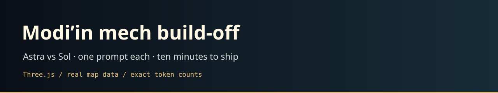
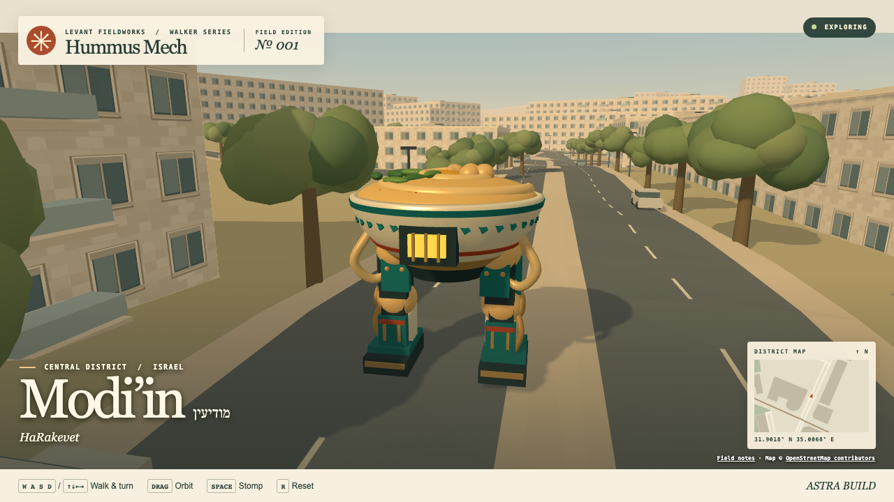
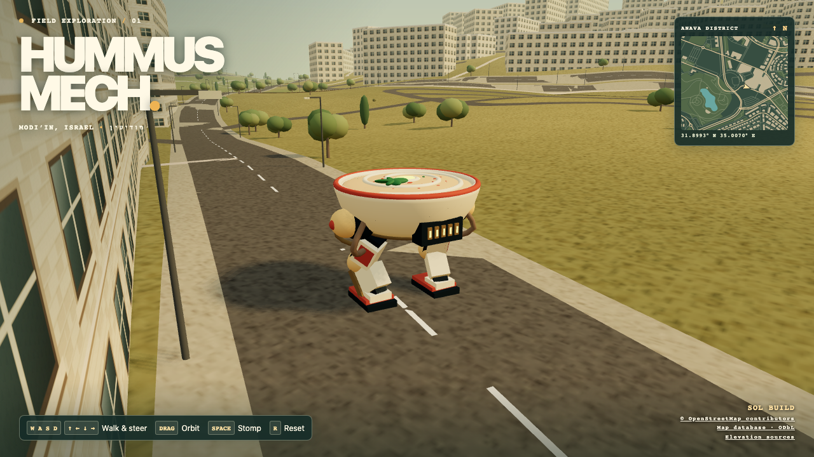
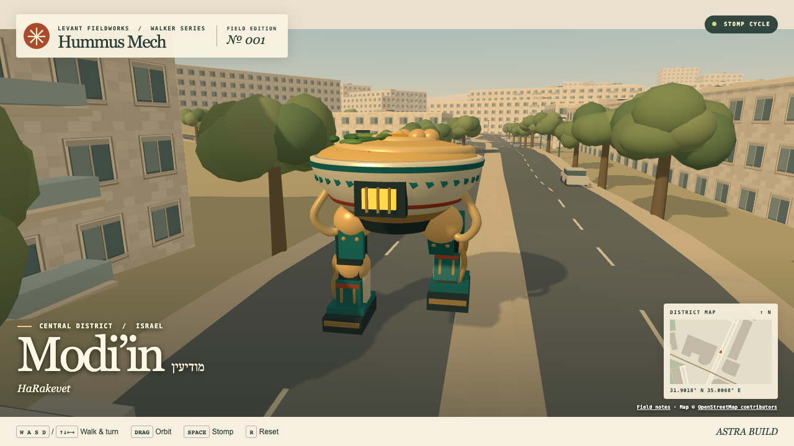
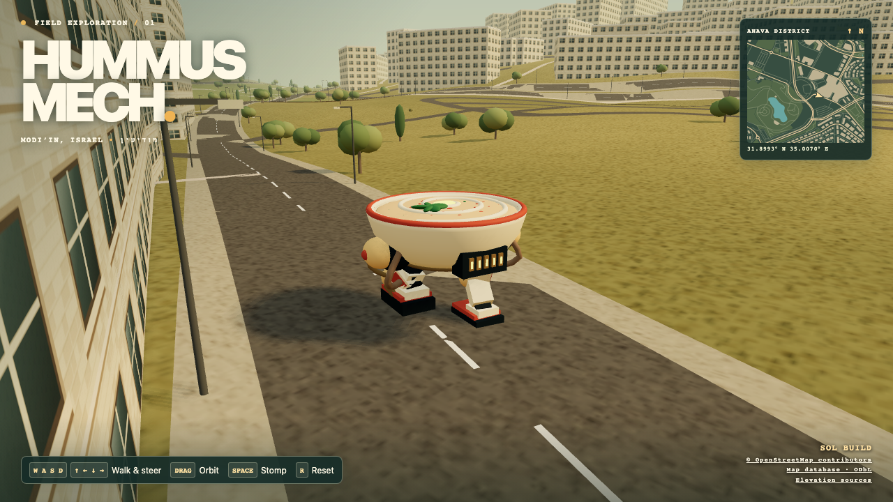

<p align="center">
  
</p>
<p align="center">
  <a href="LICENSE"></a>
  <a href="LICENSES/ODbL-1.0.txt"></a>
  <a href="https://threejs.org/"></a>
</p>

# Modi’in mech build-off

Two models got the same brief: build a playable 3D district of Modi’in, Israel, add a walking hummus mech, and deploy it within ten minutes. Each chose its own stack. Both shipped.

[Run the apps](#run-locally) · [Compare the results](#results) · [Read the prompt](benchmark/prompt.txt) · [Contribute](CONTRIBUTING.md) · [Report a bug](../../issues)

<table>
  <tr><th>Astra</th><th>Sol</th></tr>
  <tr>
    <td><a href="docs/screenshots/astra-opening.png"></a></td>
    <td><a href="docs/screenshots/sol-opening.png"></a></td>
  </tr>
  <tr><td>Plain JavaScript, Three.js, a Node copy build.</td><td>JavaScript, Three.js, Vite.</td></tr>
</table>

## Results

| Measurement | GPT-6.2 Astra | GPT-6.2 Sol |
| :--- | :--- | :--- |
| Agent completion time | 9m 23.310s | 9m 30.362s |
| Output tokens[^tokens] | 17,336 | 23,091 |
| Input tokens | 1,556,971 | 2,615,076 |
| Cached input, included above | 1,496,832 | 2,562,816 |
| Building footprints from OSM | 106 | 134 |
| Deployed within 600 seconds | Yes | Yes |
| Independent gameplay checks | Passed | Passed |

Astra used **24.9% fewer output tokens**. Completion times differed by **7.052 seconds**. The two districts overlap but have different bounds; the models chose their own scope within the brief.

> [!NOTE]
> This is one completed scored run per model on one task. It is not a general model ranking. The [method](benchmark/PROTOCOL.md) records setup failures excluded before the scored comparison, the token-accounting rule, and the limits of the evidence.

The [machine-readable results](benchmark/results.json) contain exact aggregate counters and acceptance outcomes. Private session histories, account metadata and original deployment addresses are not distributed. Publication changes remove personal branding and make the tooling portable; the recorded run metrics are unchanged. These screenshots show the publication builds.

## Run locally

Use **Node.js 22.12 or later** and npm. A recent desktop browser with WebGL 2 is required. Map geometry and terrain samples are bundled; you do not need an API key or a running map service.

```sh
npm ci
npm run dev:astra
```

Open [Astra on localhost:4322](http://localhost:4322). In a second terminal:

```sh
npm run dev:sol
```

Open [Sol on localhost:4321](http://localhost:4321). Each command builds its app before serving it. Stop with <kbd>Ctrl</kbd> + <kbd>C</kbd>. After editing source, restart to rebuild.

| Input | Action |
| :--- | :--- |
| <kbd>W</kbd> / <kbd>S</kbd> or <kbd>↑</kbd> / <kbd>↓</kbd> | Walk forward or backward |
| <kbd>A</kbd> / <kbd>D</kbd> or <kbd>←</kbd> / <kbd>→</kbd> | Turn |
| Drag | Orbit the camera |
| <kbd>Space</kbd> | Stomp |
| <kbd>R</kbd> | Reset to the starting position |

<details>
<summary>Stomp screenshots</summary>

| Astra | Sol |
| :--- | :--- |
|  |  |

Both games are silent. The mech geometry, walking animation and impact effects are procedural.

</details>

## What is real map data?

Roads, building footprints and mapped open spaces come from OpenStreetMap. Terrain follows sampled public elevation data. Facades, most building heights, trees, vehicles and street details are approximations.

Independent coordinate checks matched **313/313 road ways and 106/106 building footprints for Astra**, and **337/337 road ways and 134/134 footprints for Sol**, to the original OSM extracts. That verifies source geometry, not surveyed heights or photographic appearance.

<details>
<summary>View both district bounds on GitHub’s map</summary>

```geojson
{
  "type": "FeatureCollection",
  "features": [
    {
      "type": "Feature",
      "properties": { "name": "Astra district" },
      "geometry": { "type": "Polygon", "coordinates": [[[35.0022,31.8984],[35.0102,31.8984],[35.0102,31.9050],[35.0022,31.9050],[35.0022,31.8984]]] }
    },
    {
      "type": "Feature",
      "properties": { "name": "Sol district" },
      "geometry": { "type": "Polygon", "coordinates": [[[35.0017,31.8958],[35.0105,31.8958],[35.0105,31.9034],[35.0017,31.9034],[35.0017,31.8958]]] }
    }
  ]
}
```

These are the game areas, not a reconstruction of the entire city. See [data sources and approximations](docs/data.md).

</details>

## Build and deploy

```sh
npm run build
npm run check
npm run privacy -- --include-builds
```

Upload `apps/astra/dist/` or `apps/sol/dist/` to a static HTTPS host. Publish the full directory, including JSON data and license notices. Both builds can live under a subdirectory. The publication copy uses patched Vite 7.3.8; the recorded Sol run used 7.2.2. The repository contains no hosting account configuration and no automatic deployment workflow. See [deployment notes](docs/deployment.md).

| Layer | Astra | Sol |
| :--- | :--- | :--- |
| Renderer | Three.js 0.180.0, WebGL 2 | Three.js 0.181.2, WebGL 2 |
| Build | Node file copy | Vite |
| World | Bundled OSM geometry and elevation grid | Bundled OSM geometry and elevation grid |
| Character | Original articulated procedural mesh | Original articulated procedural mesh |
| Hosting | Static files | Static files |

<details>
<summary>Repository layout and browser checks</summary>

```text
apps/
  astra/             # Source, bundled data, static build
  sol/               # Source, bundled data, Vite build
benchmark/           # Published prompt, method and aggregate results
docs/screenshots/    # Real captures of the anonymized apps
scripts/             # Local serving, checks, privacy audit, browser tools
LICENSES/            # Data licenses and source attribution
```

Python is needed for the privacy and browser checks, not to run the apps. See [the contribution guide](CONTRIBUTING.md) for the optional Playwright setup.

</details>

## Known limits

Both are ten-minute prototypes. Building heights and road grades are simplified. Decorative trees can obstruct Astra’s orbit camera. Touch walking is not implemented. Current Chromium was tested; other browsers need verification.

Automated headless performance samples used SwiftShader software rendering. They are not hardware-accelerated browser FPS claims. The build-off did not assign a numerical aesthetics score or infer API charges from subscription token usage.

## Contributing

Read [CONTRIBUTING.md](CONTRIBUTING.md). Camera clearance, road grading and touch controls are useful starting points. Keep new experiments separate from the recorded benchmark.

## License

Original code is [MIT licensed](LICENSE). The geographic databases are separately licensed under [ODbL 1.0](LICENSES/ODbL-1.0.txt); terrain retains its [source terms and credits](LICENSES/TERRAIN.md). See [NOTICE.md](NOTICE.md) for file-level attribution.

[^tokens]: The final cumulative native-session output counter is used once. Reported reasoning output is already included: 1,483 tokens for Astra and 1,893 for Sol. Cached input is a subset of input. No repeated cumulative snapshots are summed.
