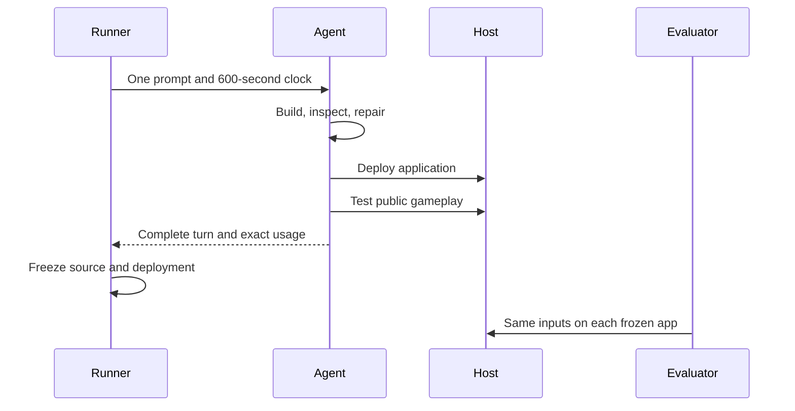

# Build-off method

Each requested GPT-6.2 model received one initial build brief, the same high reasoning setting, equivalent tool access and a hard 600-second limit. Sol ran first; order was randomized before execution. Both had a clean source directory, an initially empty package cache and a preprovisioned static-hosting destination. The models could research, test and repair their own work, but received no human correction prompt during a scored run.

## Time and completion

Research, installs, build work, browser checks, deployment and handoff counted against the limit. The parent armed a 600-second watchdog. Both agents completed before cutoff. Precise reported turn durations come from completed native session lifecycle records: 563.310 seconds for Astra and 570.362 seconds for Sol.

Public deployment and successful gameplay were required. Independent post-run checks verified walking, steering, orbit, a stomp impact, reset, key release, blur clearing, refresh and no page errors. Source hashes and deployment identities were frozen before independent evaluation. Later test tooling did not fix the apps.

## Token accounting

Use the final native session’s `token_count.info.total_token_usage` once. Do not add repeated cumulative snapshots. Reasoning output is included in reported output; cached input is included in input. Counts are provider session counters, not visible chat length or lines of code.

Exact aggregate results are published in [results.json](results.json). Raw sessions, account records, deployment IDs and host metadata are private and are not included. This prevents independent reinspection of the original full transcripts from this public repository; the published figures are aggregate evidence rather than a fully public raw-log dataset. No per-run dollar charge was measured or inferred.

## Setup failures excluded from scoring

Before valid scoring, a standalone CLI authentication path rejected the requested model before build execution. A first native attempt was then interrupted by the parent to establish complete token collection. Neither is a scored result. A clean source directory and empty package cache were restored, both models received the same revised brief, and one completed scored run per model followed. They were not hidden reruns of an evaluated failed product.

## Geography and visual comparison

Both used public OSM extracts and elevation tiles, with different overlapping district bounds. The recorded coordinate audit matched every bundled road, footprint and mapped open-space polygon to the corresponding source extract. This establishes geometry provenance, not inferred height or facade accuracy.

Astra fixed an obstructed spawn before completing. Sol repaired an excluded data file and redeployed before completing. Later visual review observed that decorative trees can obscure Astra’s orbit camera. No numerical aesthetics score was assigned; no blinded review is claimed.

## Performance scope

The headless test environment used ANGLE SwiftShader software rendering. Three warm 10-second windows without video/screenshot capture produced median-of-window-median rAF intervals of 316.6 ms for Astra and 233.3 ms for Sol. Those are measurements of that software-rendered environment, not hardware-accelerated user-browser FPS. The host was shared and manual testing was allowed. No general performance ranking follows from these samples.

## Repeat it

The [published prompt](prompt.txt) is a privacy-edited version of the run prompt: personal branding and references to unrelated private systems were removed. It is not advertised as byte-identical to the original submitted text. Provide an equivalent local environment manifest and a scoped deployment destination before starting.

Record model, reasoning, available tools, package-cache state, service tier and exact usage source. Save the prompt, UTC/elapsed timestamps, complete session counters, completion record and source/deployment identity privately. Stop at 600 seconds. Do not accept missing token totals or a partial app as completion. Publish only sanitized aggregates and app-only footage.

Keep subsequent experiments in separate result records. The published applications have privacy/portability edits after the original runs; see [publication changes](../docs/deployment.md#publication-changes).

## Publication dependency maintenance

The measured Sol run used Vite 7.2.2. The public copy pins Vite 7.3.8 to address build-tool advisories reported by the dependency audit. Three.js versions and gameplay source are unchanged apart from removal of personal branding and addition of data/license links. Publication screenshots and smoke tests use this maintained build. No new measurements are attributed to the historical run.
